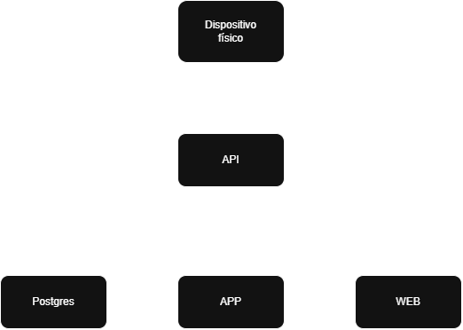
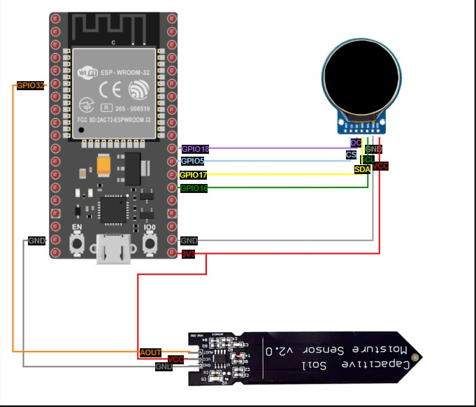

# PLANTAGOCHI

> ⚠️ **Beta** – Proyecto en desarrollo activo. Puede contener errores o cambios sin previo aviso.

## Descripción

Plantagochi es un sistema IoT animado para el cuidado y monitorización de plantas.

Mediante un dispositivo compuesto por una esp32, una pantalla y un sensor de humedad mide la humedad de una planta para poder monitorizarla desde una app y/o una web.

El sensor de humedad es el encargado de tomar las mediciones, mientras que la ESP32 utiliza estos datos para enviarlos mediante una API al servidor. El servidor almacena y procesa las mediciones, y proporciona los datos tanto a la app como a la web.

Además, el servidor es el encargado de determinar cuál es el estado de la planta según su nivel de humedad y de indicar la animación correspondiente a la ESP32, la app y la web para que el estado de la planta pueda visualizarse.

## Características

### Monitorización de la planta

- Medición de humedad del suelo mediante sensor capacitivo.
- Conversión de la lectura del sensor a un porcentaje de humedad.
- Actualización periódica de las mediciones.
- Determinación del estado de la planta según la humedad.

### Estado animado

- Diferentes estados de la planta según la medición: feliz, triste, etc.
- Cada estado tiene sus propias animaciones, compuestas por una imagen normal y dos imágenes adicionales que, al mostrarse una tras otra, generan la animación.
- El estado se muestra simultáneamente en el dispositivo físico, la app y la web, de modo que puede monitorearse tanto desde el móvil como simplemente mirando al dispositivo junto a la planta.
- La pantalla del Plantagochi cambia según las condiciones de la planta, de modo que su estado puede verse de una manera muy visual.

### Comunicación IoT

- La ESP32 es la encargada de recoger las mediciones.
- La ESP32 envía los datos al servidor mediante la API.
- Tanto la app como la web y el dispositivo físico (en este caso, solo mediante la animación) reciben los datos de la API.
- En la ESP32 se define el ID del dispositivo, que posteriormente se asocia a un registro de planta, permitiendo relacionar las mediciones con la planta correspondiente.

### Aplicación móvil

- Muestra los datos de las plantas, tanto sus mediciones como el resto de información asociada.
- Permite añadir, editar y eliminar plantas.
- Permite añadir, editar y eliminar tipos de planta, incluyendo el nombre del tipo de planta y las imágenes utilizadas para las animaciones de cada estado.

### Aplicación web

- Muestra los datos mínimos de las plantas, incluyendo su estado y nombre.
- Permite añadir, editar y eliminar tipos de planta, al igual que la aplicación móvil (la gestión de las plantas en sí se hace solo desde la app móvil).

### Backend y datos

- API REST desarrollada con FastAPI.
- PostgreSQL para almacenar los datos.
- Docker para ejecutar los servicios.
- Nginx como proxy.
- Comunicación entre los diferentes componentes del sistema.

## Arquitectura



## Tecnologías

### Backend

- **Python** como lenguaje principal.
- **FastAPI** para el desarrollo de la API REST.
- **PostgreSQL** como sistema de gestión de base de datos.
- **pgvector** para el almacenamiento y búsqueda de embeddings, para posible integración con otros proyectos.
- **Docker** y **Docker Compose** para la ejecución y gestión de los servicios.
- **Nginx** como proxy inverso.

### Aplicación móvil

- **React Native** para el desarrollo de la aplicación móvil.
- **Expo** para facilitar el desarrollo y la generación de la aplicación.

### Aplicación web

- **React** para el desarrollo de la aplicación web.

### Dispositivo IoT

- **ESP32** como microcontrolador del dispositivo.
- **C++** para la programación del dispositivo.
- **TFT_eSPI** para la gestión de la pantalla.
- **Sensor capacitivo de humedad** para la medición de la humedad del suelo.

### Infraestructura y comunicación

- **API REST** como punto central de comunicación entre el dispositivo, las aplicaciones y la base de datos.
- **Docker Compose** para orquestar la API, la base de datos y la web, con redes externas para poder poner un proxy inverso por delante.
- **Exposición de los servicios**: la API escucha en el puerto 8000 y la web en el 80. Cómo se llega a ellos desde fuera (dominio propio, proxy inverso, VPN, túnel o abrir puertos) depende de la infraestructura de cada despliegue y no forma parte del proyecto.

## Hardware

### Componentes

- **ESP32** como controlador principal del dispositivo.
- **Pantalla TFT circular GC9A01 de 1,28"** para mostrar el estado y las animaciones de la planta.
- **Sensor capacitivo de humedad del suelo** para obtener las mediciones de humedad.
- **Alimentación mediante batería externa (power bank) o alimentación directa mediante adaptador de 5v**.

### Conexiones

El sensor de humedad y la pantalla se conectan directamente a la ESP32.



### Pantalla TFT GC9A01

| ESP32   | Pantalla |
| ------- | -------- |
| GND     | GND      |
| 3V3     | VCC      |
| GPIO 5  | CS       |
| GPIO 16 | SCL      |
| GPIO 17 | SDA      |
| GPIO 18 | DC       |

### Sensor de humedad

| ESP32   | Sensor |
| ------- | ------ |
| GND     | GND    |
| 3V3     | VCC    |
| GPIO 32 | AOUT   |

### Configuración de la pantalla

En `TFT_eSPI`, los pines utilizados son:

```cpp
#define TFT_CS   5
#define TFT_DC   18
#define TFT_SCLK 16
#define TFT_MOSI 17
```

### Funcionamiento del dispositivo

La ESP32 obtiene periódicamente la medición del sensor de humedad y la transforma en un porcentaje de humedad.

A partir de este valor se determina el estado de la planta y se muestra la animación correspondiente en la pantalla. Además, la ESP32 comunica la información con la API para que el estado y las mediciones puedan consultarse desde la aplicación móvil y la web.

## Estructura del proyecto

```text
plantagochi/
├── api/            # Backend FastAPI + Docker Compose (API y PostgreSQL)
├── web/            # Aplicación web (React + Vite + Nginx)
├── mobile/         # Aplicación móvil (React Native + Expo)
├── esp32_code/     # Código del dispositivo IoT (Arduino / C++)
├── images/         # Imágenes de este README
└── db              # Esquema de la base de datos (SQL)
```

La configuración personal de cada app **no se versiona**: `.env`, `eas.json` y
`config.h` llevan datos de tu instalación y tienen su plantilla `.example` para
copiar.

## Requisitos

- **Docker** y **Docker Compose** para la API, la base de datos y la web.
- **Node.js 22+** para desarrollo local de la web y la app móvil.
- **Expo CLI** (opcional, se usa vía `npx expo`) para la app móvil.
- **Arduino IDE** con la librería **TFT_eSPI** para programar la ESP32.
- Una red `proxy` de Docker (y `api_default`) creada previamente, ya que ambos `docker-compose.yml` las declaran como redes externas:

```bash
docker network create proxy
docker network create api_default
```

## Puesta en marcha

### 1. Backend (API + base de datos)

```bash
cd api
cp .env.example .env   # rellenar DB_*, FRONTEND_URL y OLLAMA_URL
docker compose up -d --build
```

> **Antes de arrancar la API por primera vez**, hay que crear el esquema en la
> base de datos aplicando el fichero `db` (con `psql` o el cliente que uses).
> La API **no** crea tablas ni columnas por su cuenta: parte de que el esquema
> ya está aplicado. Si falta algo, fallará con el error de Postgres
> correspondiente.

- La API queda expuesta en el puerto `8000` y la documentación interactiva en `http://localhost:8000/docs`.
- Los datos se persisten en el volumen `plantagochi_postgres_data`.
- Los exports mensuales se guardan en `api/exports/`.

Para ejecutarla en local sin Docker:

```bash
cd api
pip install -r requirements.txt
uvicorn main:app --reload
```

### 2. Aplicación web

```bash
cd web
cp .env.example .env   # VITE_API_URL y VITE_API_ALL_PART
npm install
npm run dev            # desarrollo en http://localhost:5173
```

En producción se sirve con Docker y Nginx:

```bash
cd web
docker compose up -d --build
```

Las variables `VITE_*` se inyectan en tiempo de build a través de los `ARG` del `Dockerfile`.

### 3. Aplicación móvil

Requisitos previos:

- **Node.js 22+**.
- Una cuenta de **Expo** (gratuita) si vas a generar builds distribuibles con EAS.
- El fichero **`google-services.json`** de Firebase, solo si quieres probar las notificaciones push (ver más abajo).

Paso 1. Configurar la URL de la API:

```bash
cd mobile
cp .env.example .env   # EXPO_PUBLIC_API_URL con la URL de la API
```

`EXPO_PUBLIC_API_URL` debe ser una URL **alcanzable desde el propio móvil** (la IP de tu red local o un dominio), no `localhost`. El móvil es un dispositivo distinto del servidor, así que `http://localhost:8000` apuntará al propio móvil y no funcionará.

Paso 2. Instalar y arrancar:

```bash
npm install
npm start               # o npm run android / npm run ios
```

Paso 3. Generar un build distribuible (opcional) con EAS.

`eas.json` no se versiona porque lleva la URL de la API de tu servidor. Cópialo
desde la plantilla y pon la tuya:

```bash
cp eas.json.example eas.json
# editar EXPO_PUBLIC_API_URL en el perfil que vayas a usar
npx eas-cli build --profile preview --platform android
```

Los perfiles son `development` (con development client), `preview` (distribución
interna) y `production`. La URL se define en el bloque `env` del perfil que uses.
`EXPO_PUBLIC_API_URL` se inlinea en el bundle al compilar, así que **cambiarla
obliga a reconstruir** la app.

#### Notificaciones push (opcional, Android)

Para que el móvil reciba avisos cuando una planta necesita riego, Android necesita el fichero `google-services.json` de Firebase. Sin él, la app funciona igual, pero no llegan las notificaciones en segundo plano.

Cómo conseguirlo:

1. Entra en [console.firebase.google.com](https://console.firebase.google.com) y abre (o crea) el proyecto de Plantagochi.
2. Añade una app **Android** con el paquete `com.ido.dev.plantagochi`. El paquete debe coincidir exactamente; lo tienes en `mobile/app.json`, en `expo.android.package`.
3. Descarga el fichero `google-services.json` y colócalo en la carpeta `mobile/`.
4. No se sube al repositorio: ya está en `mobile/.gitignore`, porque contiene claves del proyecto.

> Las notificaciones push **no** se pueden probar en **Expo Go**: necesitan un build nativo (`npx eas-cli build --profile development` o `preview`). En Expo Go sí se puede usar la app para el resto (listar plantas, editar tipos, etc.), pero sin push remotas.

Al crear una planta desde la app se le asigna un `device_id`. Apunta ese mismo valor: es el que hay que poner en `DEVICE_ID` de `config.h` en la ESP32 para enlazarlas (ver más abajo).

### 4. Dispositivo IoT (ESP32)

1. Instalar la librería **TFT_eSPI** en Arduino IDE y configurar los pines indicados en [Configuración de la pantalla](#configuración-de-la-pantalla).
2. Copiar la plantilla de configuración y rellenarla:

```bash
cd esp32_code/plantagochi
cp config.example.h config.h
```

3. Definir en `config.h` el `DEVICE_ID`, la `BASE_URL` de la API, las credenciales WiFi y la calibración del sensor (`HUM_RAW_DRY` / `HUM_RAW_WET`).

   El `DEVICE_ID` **debe ser exactamente el mismo** `device_id` que se introdujo al crear la planta desde la app móvil, y esa planta debe existir ya en la base de datos. Ese identificador es lo que vincula la ESP32 con su planta: los `POST /plantagochi/state` buscan la planta por `device_id`, así que si no coincide (o la planta no existe todavía), el servidor responderá `404 device_id desconocido`.
4. Subir el sketch a la ESP32.

## API

Todas las rutas cuelgan del prefijo `/plantagochi`. Resumen de los endpoints, agrupados por tipo.

### Plantas

| Método | Ruta | Descripción |
| ------ | ---- | ----------- |
| `GET` | `/plantagochi/all` | Lista todas las plantas con su estado y última medición. |
| `GET` | `/plantagochi/device/{device_id}` | Planta asociada a un `device_id`. |
| `GET` | `/plantagochi/last-update` | Firma de la última actualización (estado, plantas e imágenes) para el polling de la app y la web. |
| `POST` | `/plantagochi` | Crea una planta (y genera su embedding). |
| `PUT` | `/plantagochi/{plant_id}` | Actualiza una planta. |
| `PATCH` | `/plantagochi/{plant_id}/threshold` | Actualiza el umbral de riego. |
| `DELETE` | `/plantagochi/{plant_id}` | Elimina una planta. |

### Ingesta de humedad (ESP32)

| Método | Ruta | Descripción |
| ------ | ---- | ----------- |
| `POST` | `/plantagochi/state` | Ingesta de humedad por `device_id` (la que usa la ESP32). |
| `POST` | `/plantagochi/{plant_id}` | Ingesta de humedad por id de planta (ruta antigua, se mantiene por compatibilidad). |

### Tipos de planta

| Método | Ruta | Descripción |
| ------ | ---- | ----------- |
| `GET` | `/plantagochi/types` | Lista los tipos de planta. |
| `POST` | `/plantagochi/types` | Crea un tipo de planta. |
| `POST` | `/plantagochi/types/{type_id}/images` | Sube y/o actualiza el nombre y las imágenes de un tipo (multipart). |
| `POST` | `/plantagochi/types/images/refresh` | Regenera las imágenes de todos los tipos desde `api/images/`. |
| `POST` | `/plantagochi/types/{type_id}/images/refresh` | Regenera las imágenes de un tipo concreto. |

### Imágenes de tipo (para la ESP32 y el dashboard)

| Método | Ruta | Descripción |
| ------ | ---- | ----------- |
| `GET` | `/plantagochi/types/{type_id}/manifest` | Manifest: qué frames hay y cuánto ocupa cada uno (lo usa la ESP32). |
| `GET` | `/plantagochi/types/{type_id}/images/{state}/raw` | Un frame RGB565 crudo (`?frame=0..2`, por defecto 0). |
| `GET` | `/plantagochi/types/{type_id}/images/{state}/png` | Un frame en PNG (`?frame=0..2`, por defecto 0). |
| `GET` | `/plantagochi/types/{type_id}/images/{state}/all/raw` | Los 3 frames del estado concatenados. |

### Búsqueda semántica

| Método | Ruta | Descripción |
| ------ | ---- | ----------- |
| `POST` | `/plantagochi/search` | Busca plantas por descripción en lenguaje natural (embeddings). |

### Notificaciones push

| Método | Ruta | Descripción |
| ------ | ---- | ----------- |
| `POST` | `/plantagochi/push-token` | Registra el token de push de un móvil. |

> Dar de baja un token **no** tiene endpoint: lo gestiona el propio servidor.
> Cuando Expo responde `DeviceNotRegistered` (app desinstalada o permiso
> revocado), la API borra el token sola desde `api/push.py`. Por eso se registra
> un push pero no hay una ruta para eliminarlo desde la app.

Estados disponibles: `superhappy`, `happy`, `sad` y `supersad`.

## Mantenimiento y operaciones

- **Copia de seguridad**: un volcado con `pg_dump` de la base de datos `plants` desde el contenedor de Postgres.
- **Esquema**: `db` contiene el SQL del esquema (migraciones v1–v4, incluida la extensión `pgvector`) y es la única fuente de verdad del esquema: se aplica a mano y la API no lo modifica en tiempo de ejecución.
- **Exports mensuales**: la API exporta automáticamente el registro de plantas el día 1 de cada mes (si el servidor estaba apagado, se ejecuta en el siguiente arranque). El histórico se puede consultar con `GET /plantagochi/exports`.
- **Acceso remoto**: opcional y a cargo de quien despliega. Los `docker-compose.yml` se enganchan a las redes externas `proxy` y `api_default` para poder poner delante un proxy inverso (Nginx, Traefik, Caddy...) y servir web y API bajo el mismo dominio. Si no lo usas, basta con abrir el puerto 8000 de la API y el 80 de la web.

## Comandos de desarrollo

| Componente | Comando | Descripción |
| ---------- | ------- | ----------- |
| `web/` | `npm run dev` | Servidor de desarrollo con HMR. |
| `web/` | `npm run build` | Build de producción. |
| `web/` | `npm run preview` | Sirve localmente el build de producción. |
| `web/` | `npm run lint` | Lint con ESLint. |
| `mobile/` | `npm start` | Inicia Expo. |
| `mobile/` | `npm run android` | Inicia Expo en Android. |
| `mobile/` | `npm run ios` | Inicia Expo en iOS. |
| `mobile/` | `npm run lint` | Lint con ESLint. |
| `api/` | `uvicorn main:app --reload` | API en modo desarrollo. |
